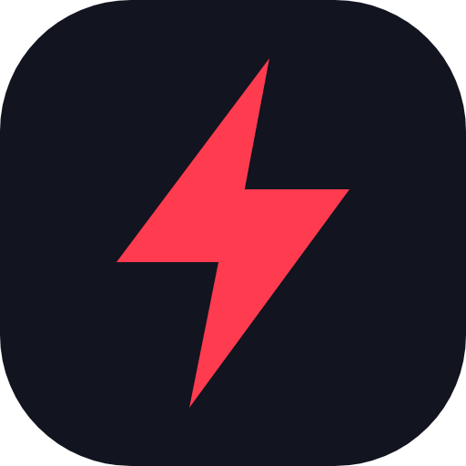
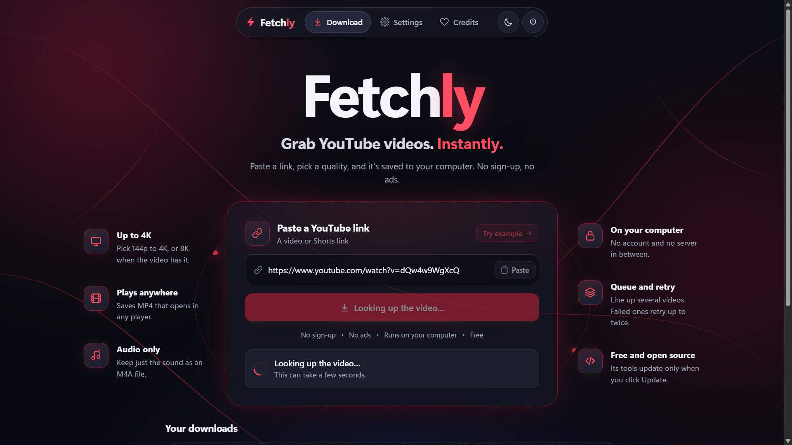
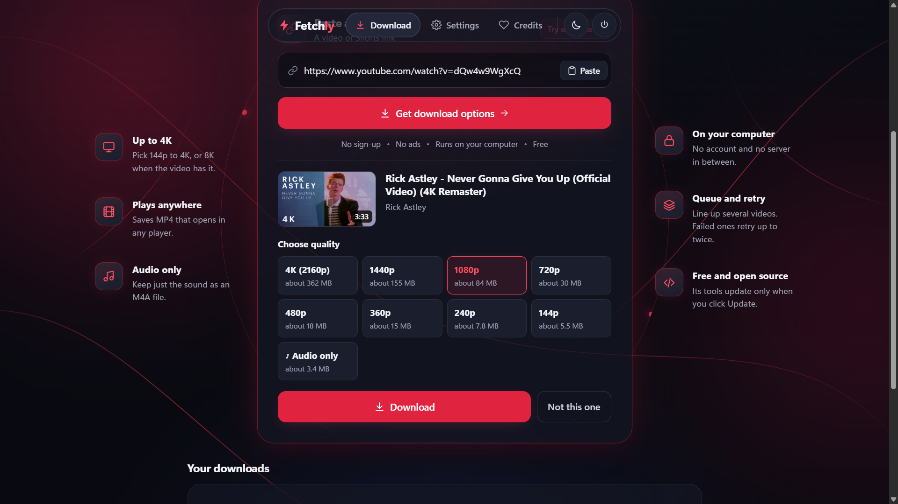
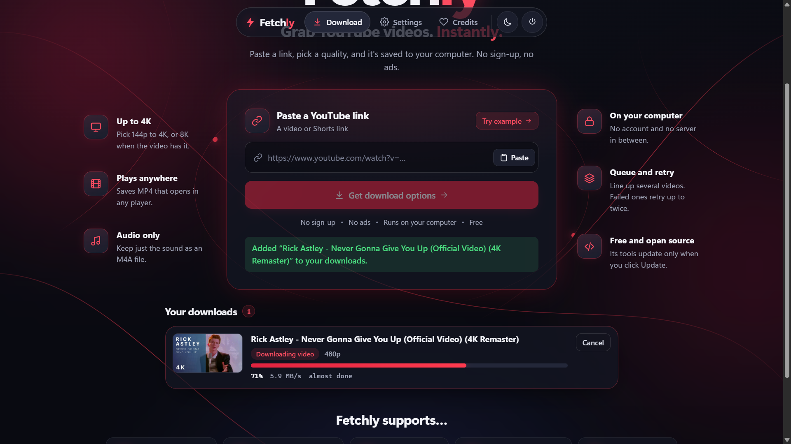
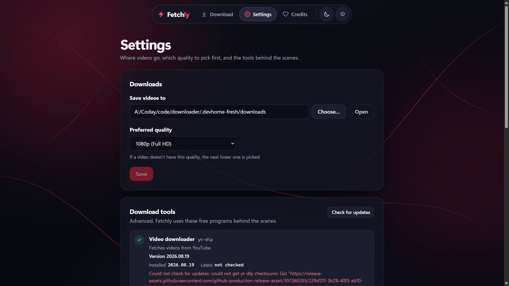
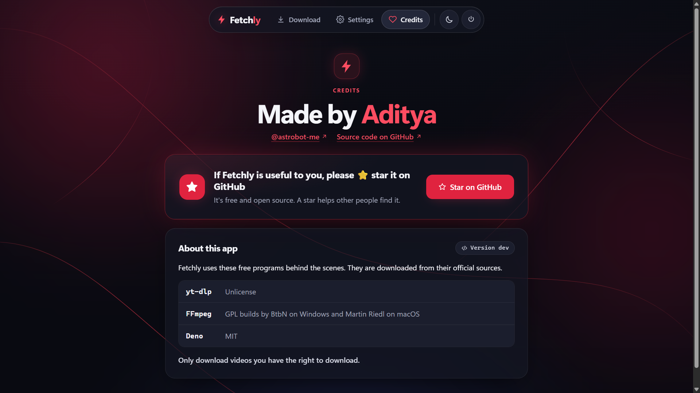

<p align="center">
  
</p>

<h1 align="center">Fetchly</h1>

<p align="center">
  <b>Grab YouTube videos. Instantly.</b><br>
  Paste a link, pick a quality, and it's saved to your computer.<br>
  No sign-up, no ads, no server in between.
</p>

<p align="center">
  <a href="https://github.com/astrobot-me/fetchly/releases/latest"><b>Download</b></a> ·
  <a href="#how-it-works">How it works</a> ·
  <a href="#build-from-source">Build from source</a>
</p>

<p align="center">
  
</p>

## What it does

Fetchly is a small app that runs on your own computer and opens in your web browser. It downloads YouTube videos with [yt-dlp](https://github.com/yt-dlp/yt-dlp) and [FFmpeg](https://ffmpeg.org), wrapped in a simple interface for people who don't want to use a terminal.

- **Pick your quality.** Anything from 144p up to 4K, or 8K when the video has it. Each option shows its approximate size.
- **Audio only.** Keep just the sound as an M4A file.
- **Files that play everywhere.** Videos are saved as MP4, preferring H.264 so they open in any player. (Above 1080p, YouTube only offers VP9 or AV1.)
- **A download queue.** Add several videos, watch the progress, speed and time left, and cancel at any time.
- **Same video, several qualities.** Each gets its own file, named with the quality, like `My video [abc123] 1080p.mp4`.
- **A tidy download folder.** Unfinished pieces stay in a hidden `.cache` folder; only finished files appear.
- **Problems in plain words.** Failed downloads are retried twice, then Fetchly explains what went wrong.
- **Updates only when you say so.** Fetchly checks for newer versions of its tools, but installs nothing until you click **Update**, and can roll back.
- **Dark and light themes.** Dark by default.

Single videos and Shorts links are supported. Playlists, channels and live streams are not (yet).

## Screenshots

| Choose a quality | Download progress |
|---|---|
|  |  |

| Settings | Credits |
|---|---|
|  |  |

## Install

1. Download **Fetchly.zip** from the [latest release](https://github.com/astrobot-me/fetchly/releases/latest) and unzip it.
2. Double-click **start.bat** (Windows) or **start.command** (Mac).
3. Your browser opens Fetchly. Keep the small window open while you use it; close it, or press the power button in the app, to stop.

The first start takes a few minutes: Fetchly downloads itself (about 8 MB) and then its tools (about 300 MB). After that it starts in seconds.

**Windows:** if you see "Windows protected your PC", click **More info**, then **Run anyway**.
**Mac:** right-click **start.command**, choose **Open**, then click **Open** again. You only need to do this once.

On Windows you can also download `fetchly-windows-amd64.exe` from the release and run it directly.

**Requirements:** Windows 10 or 11 (64-bit), or macOS on Apple Silicon or Intel. The macOS version is a preview and hasn't been tested on a real Mac yet.

## How it works

```
start.bat / start.command      downloads fetchly(.exe) once, checks its SHA-256, runs it
        │
fetchly (Go)  ── serves the UI and an API on 127.0.0.1 only
        │          ├─ downloads, verifies and updates yt-dlp, FFmpeg and Deno
        │          └─ runs yt-dlp for each download (FFmpeg joins video + audio)
        ▼
your browser ── the React UI, talking to the backend with a per-launch token
```

- **Everything stays on your computer.** The server only listens on `127.0.0.1`, checks the `Host` and `Origin` of every request, and requires a random token created at each start.
- **Nothing is installed system-wide.** The app and its tools live in `%LOCALAPPDATA%\Fetchly` on Windows and `~/Library/Application Support/Fetchly` on macOS. Delete that folder to remove it; your videos are untouched.
- **Verified downloads.** The launchers check the app, and the app checks every tool, against published SHA-256 checksums before running anything.
- **Network use:** YouTube for your downloads, and GitHub and the tool download sites to install the tools and check for updates.

## Build from source

You need **Go 1.26+**, **Node 24+** and **git**. On Windows, use PowerShell.

```
fetchly/
├── ytgui-backend/     Go backend: API, job runner, updater; embeds the built UI
│   └── launchers/     start.bat, start.command, README.txt (the user zip)
├── ytgui-web/         React + Vite UI
├── scripts/           release.ps1, plus mkzip and mkicon helpers
└── release-notes/     notes per version and the template for new ones
```

**Run it locally:**

```powershell
cd ytgui-web
npm ci
npm run build                      # builds the UI into ytgui-web/dist

cd ../ytgui-backend
Remove-Item web/dist/* -Recurse -Exclude .gitkeep
Copy-Item ../ytgui-web/dist/* web/dist -Recurse
go build -o out/fetchly.exe .
./out/fetchly.exe                  # opens the app in your browser
```

Useful backend commands: `fetchly versions`, `fetchly update [tool]`, `fetchly rollback <tool>`, `fetchly info <url>` and `fetchly get <url> [quality]`.

For UI work, `npm run dev` serves the UI on port 5173 and proxies `/api` to a backend built with `go build -tags dev`. Stop the dev server before running a release; it locks files in `node_modules` on Windows.

**Make a release:**

```powershell
./scripts/release.ps1 -Version 0.1.1             # build: 3 binaries, Fetchly.zip, checksums.txt
./scripts/release.ps1 -Version 0.1.1 -Release    # also write release-notes/0.1.1.md
./scripts/release.ps1 -Version 0.1.1 -Publish    # also upload as a draft GitHub release
```

Output goes to `out/release/<version>/`. A draft release isn't visible to the launchers until you publish it on GitHub.

## Credits

Made by **Aditya** ([@astrobot-me](https://github.com/astrobot-me)).

If Fetchly is useful to you, please ⭐ [star it on GitHub](https://github.com/astrobot-me/fetchly). It helps other people find it.

Fetchly downloads these tools from their official sources:

- [yt-dlp](https://github.com/yt-dlp/yt-dlp): Unlicense
- [FFmpeg](https://ffmpeg.org): GPL builds by [BtbN](https://github.com/BtbN/FFmpeg-Builds) on Windows and [Martin Riedl](https://ffmpeg.martin-riedl.de) on macOS
- [Deno](https://deno.com): MIT

## License

<!-- TODO: choose a license (for example MIT) and add a LICENSE file. -->
A license hasn't been chosen yet.

---

Only download videos you have the right to download. Fetchly isn't affiliated with YouTube or Google.
